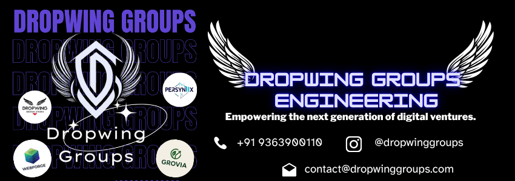
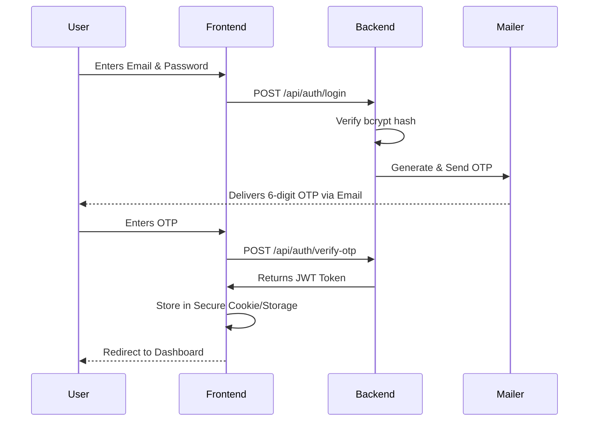
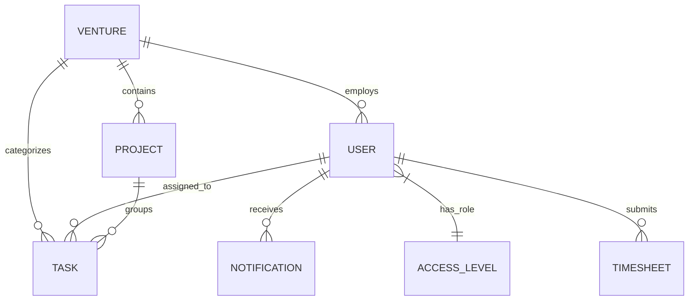

<div align="center">

# ✦ InternalX

> **The Ultimate Enterprise Command Center for Dropwing Groups.**

A highly scalable, full-stack, multi-tenant enterprise management portal empowering seamless cross-venture collaboration with granular role-based access control.

[**Documentation**](#-getting-started) • [**Features**](#-key-features) • [**API Reference**](#-api-documentation) • [**Architecture**](#-architecture) • [**Mobile App**](#-mobile-app)

<!-- Badges -->


<br/>



</div>

---

## 📖 Table of Contents

- [Project Overview](#-project-overview)
- [Visual Documentation](./docs/VISUAL_DOCUMENTATION.md)
- [Key Features](#-key-features)
- [Screenshots](#-screenshots)
- [Architecture](#-architecture)
- [Tech Stack](#-tech-stack)
- [Project Structure](#-project-structure)
- [Getting Started](#-getting-started)
- [Environment Variables](#-environment-variables)
- [API Documentation](#-api-documentation)
- [Database Schema](#-database-schema)
- [Authentication & Access Control](#-authentication--access-control)
- [Security](#-security)
- [Performance](#-performance)
- [Deployment](#-deployment)
- [Testing](#-testing)
- [Troubleshooting](#-troubleshooting)
- [Roadmap](#-roadmap)
- [Contributing](#-contributing)
- [License](#-license)

---

## 🌐 Project Overview

**InternalX** is the unified, enterprise-grade operating system for **Dropwing Groups**, managing four distinct ventures under a single cohesive platform.

### The Problem
Managing multiple companies (ventures) typically requires fragmented tools for chat, project management, file storage, and HR. This leads to siloed data, complex access management, and excessive software costs.

### The Solution
InternalX unifies **Task & Project Management, Real-Time Messaging, HR, Finances, Document Storage, and Client Portals** into one secure, centralized command center.

### The Ventures

| Venture | Slug | Brand Color | Domain Focus |
|---------|------|-------------|--------------|
| **Dropwing Design Studio** | `dropwing` | `#8B5CF6` (Purple) | Creative design, UI/UX, and brand identity |
| **Fenixa Solutions** | `fenixa` | `#06B6D4` (Cyan) | Software development & scalable SaaS solutions |
| **PerSyniX** | `persynix` | `#F59E0B` (Amber) | Artificial Intelligence & Machine Learning |
| **Grovia** | `grovia` | `#10B981` (Green) | Marketing, SEO, and business growth |

---

## ✨ Key Features

| Feature | Description |
| ------- | ----------- |
| 🏢 **Multi-Tenant Architecture** | Seamlessly manage 4 ventures in one unified platform. |
| 🎚️ **Granular RBAC** | 9 distinct access tiers (L1 Super Admin → L9 Client). |
| 💬 **Real-Time Communication** | WebSocket-powered channels and direct messaging (Socket.IO). |
| 📊 **Advanced Analytics** | Interactive Recharts-powered dashboards and cross-venture KPIs. |
| 📁 **Secure Document Vault** | Role-gated file storage with enterprise-grade encryption tracking. |
| 💼 **Financial & HR Suite** | Timesheets, budget tracking, automated invoicing, and department OKRs. |
| 📱 **Mobile Ecosystem** | Cross-platform Flutter app for on-the-go enterprise access. |
| 🎓 **Learning Hub** | Automated onboarding checklists, intern tracking, and feedback loops. |
| 🎨 **Dynamic Theming** | Glassmorphism UI that automatically adapts to the user's venture brand color. |
| 🔔 **Notification Engine** | Real-time in-app alerts and automated Hostinger SMTP email triggers. |

---

## 🖼️ Screenshots

<details>
<summary>Click to view screenshots</summary>

### Desktop / Web App

*Unified dashboard with multi-venture analytics.*

### Mobile App (Flutter)

*Native iOS and Android experience.*

### Dark Mode & Glassmorphism

*Premium dark theme with venture-specific accent colors.*
</details>

---

## 🏗️ Architecture

InternalX leverages a modern, decoupled architecture designed for high availability and low latency.

### System Architecture

```mermaid
graph TD
    Client[Web Client (Next.js 15)] -->|HTTPS / REST| API[API Server (Express.js)]
    MobileClient[Mobile App (Flutter)] -->|HTTPS / REST| API
    
    Client -->|WebSocket| WSS[Socket.IO Server]
    MobileClient -->|WebSocket| WSS
    
    WSS <--> API
    
    API -->|Read/Write| DB[(MySQL Database)]
    API -->|Read/Write| Storage[Local/Cloud Storage]
    API -->|SMTP| Mail[Hostinger SMTP Server]
    
    subgraph Infrastructure
    DB
    Storage
    Mail
    end
```

### Authentication Flow (JWT + OTP)



---

## 💻 Tech Stack

| Category | Technology |
|----------|------------|
| **Frontend Web** | Next.js 15 (App Router), React 19, Tailwind CSS, Framer Motion, Recharts |
| **Mobile App** | Flutter 3.x, Riverpod, GoRouter, Dio |
| **Backend API** | Node.js 18+, Express.js 4, Socket.IO 4 |
| **Database** | MySQL / MariaDB 3 |
| **Authentication** | JSON Web Tokens (JWT), bcryptjs, OTP-based 2FA |
| **File Storage** | Multer (Local Storage) |
| **Email Service** | Nodemailer with Hostinger SMTP |
| **Type Safety** | TypeScript 5 (Frontend) |
| **Linting & Code Style**| ESLint, Prettier, flutter_lints |

---

## 📁 Project Structure

```text
InternalXDropwing/
├── backend/                  # Node.js + Express API
│   ├── src/
│   │   ├── config/           # DB schema, migration scripts, env config
│   │   ├── controllers/      # API logic (Auth, Tasks, Chat, etc.)
│   │   ├── middleware/       # JWT Auth, RBAC validation
│   │   ├── routes/           # Express REST endpoints
│   │   ├── services/         # Email, Audit logging
│   │   └── server.js         # Entry point & WebSocket setup
│   ├── uploads/              # Secure document vault storage
│   └── seed.js               # Database population script
│
├── frontend/                 # Next.js Web App
│   ├── src/
│   │   ├── app/              # App Router pages (Dashboard, Settings)
│   │   ├── components/       # Reusable UI (Buttons, Modals, Charts)
│   │   └── lib/              # Axios client, types, utility functions
│   └── public/               # Static assets
│
└── mobile/                   # Flutter Cross-Platform App
    ├── lib/
    │   ├── features/         # Feature-first architecture (Auth, Chat)
    │   ├── core/             # Routing, Networking, Theming
    │   └── main.dart         # Flutter entry point
    └── pubspec.yaml          # Dependencies
```

---

## 🚀 Getting Started

Follow these instructions to run InternalX locally for development.

### Prerequisites
- [Node.js](https://nodejs.org/) (v18 or higher)
- [MySQL](https://www.mysql.com/) or [MariaDB](https://mariadb.org/)
- [Flutter SDK](https://flutter.dev/docs/get-started/install) (for mobile app)
- [Git](https://git-scm.com/)

### 1. Clone the Repository
```bash
git clone https://github.com/dropwing-groups/InternalXDropwing.git
cd InternalXDropwing
```

### 2. Setup the Backend
```bash
cd backend
npm install

# Initialize the database
mysql -u root -p < src/config/create_db.sql

# Seed the database with 30+ test accounts
node seed.js

# Run migrations (if necessary)
node migrate-learning.js
node migrate-notifications.js
```

### 3. Setup the Frontend
```bash
cd ../frontend
npm install
```

### 4. Setup Mobile App (Optional)
```bash
cd ../mobile
flutter pub get
```

### 5. Start Development Servers
Open two terminals to run both web servers:

**Terminal 1: Backend**
```bash
cd backend
npm run dev
# Server running on http://localhost:5000
```

**Terminal 2: Frontend Web**
```bash
cd frontend
npm run dev
# Web app running on http://localhost:3000
```

---

## ⚙️ Environment Variables

Create `.env` files in both `backend/` and `frontend/` directories.

### `backend/.env`
| Variable | Description | Required | Example |
|----------|-------------|----------|---------|
| `PORT` | API Server Port | Yes | `5000` |
| `DB_HOST` | Database Host | Yes | `localhost` |
| `DB_PORT` | Database Port | Yes | `3306` |
| `DB_NAME` | Database Name | Yes | `u247884947_InternalDG` |
| `DB_USER` | Database User | Yes | `root` |
| `DB_PASSWORD`| Database Password | Yes | `secret123` |
| `JWT_SECRET` | Secret key for JWT | Yes | `your_super_secret_key` |
| `JWT_EXPIRES_IN`| Token expiry time | Yes | `8h` |
| `SMTP_HOST` | Hostinger SMTP Host | Yes | `smtp.hostinger.com` |

### `frontend/.env.local`
| Variable | Description | Required | Example |
|----------|-------------|----------|---------|
| `NEXT_PUBLIC_API_URL`| Backend API URL | Yes | `http://localhost:5000/api` |
| `NEXT_PUBLIC_SOCKET_URL`| WebSocket Server URL | Yes | `http://localhost:5000` |

---

## 🔌 API Documentation

All protected routes require a Bearer Token: `Authorization: Bearer <JWT_TOKEN>`

### Core Endpoints

| Method | Endpoint | Description | Access Level |
|--------|----------|-------------|--------------|
| `POST` | `/api/auth/login` | Authenticate user (Triggers OTP) | Public |
| `POST` | `/api/auth/verify-otp`| Verify OTP and issue JWT | Public |
| `GET`  | `/api/auth/me` | Fetch active session profile | All Authenticated |
| `GET`  | `/api/users` | List venture-scoped users | L1 - L5 |
| `POST` | `/api/tasks` | Create task & trigger email | L1 - L7 |
| `GET`  | `/api/projects` | Fetch venture projects | L1 - L9 |
| `GET`  | `/api/chat/messages` | Retrieve real-time channel logs| L1 - L9 |
| `POST` | `/api/documents` | Upload a secure file (Multer) | L1 - L9 |

*Full API specification is available via Postman collection (coming soon).*

---

## 🗄️ Database Schema

InternalX uses a highly relational MySQL database design.



**Core Tables:**
- `ventures`: Defines the 4 operating companies.
- `access_levels`: Matrix of 9 role definitions (L1-L9).
- `users`: Employee/Client master records.
- `tasks` / `projects`: Project management suite.
- `messages`: Persistent WebSocket chat history.
- `documents`: Vault metadata.

---

## 🔐 Authentication & Access Control

InternalX utilizes a strict **9-Tier Access Level (L1-L9)** system:

| Level | Role | Scope | Key Capabilities |
|-------|------|-------|------------------|
| **L1**| **Super Admin** | Global | Full system access, audit logs, DB management |
| **L2**| **Managing Director** | Global | Cross-venture KPIs, financials, strategy |
| **L3**| **Admin** | Venture | Full venture control, user management |
| **L4**| **CXO** | Venture | Department OKRs, budget allocation |
| **L5**| **Manager** | Venture | Team dashboard, project workflows |
| **L6**| **Exec Staff** | Venture | Advanced task creation, timesheets |
| **L7**| **Staff** | Venture | Standard task execution, documents |
| **L8**| **Intern** | Venture | Learning Hub, onboarding checklists |
| **L9**| **Client** | Venture | Read-only portal, deliverables, invoices |

---

## 🛡️ Security

Enterprise security is built into the core:
- **Two-Factor Authentication (2FA):** Mandatory OTP for unverified devices.
- **Role-Based Access Control (RBAC):** Backend middleware prevents privilege escalation.
- **Venture Isolation:** L3-L9 users are strictly locked to their assigned venture database rows.
- **Secure Headers:** Implementation of `helmet.js` to mitigate XSS and clickjacking.
- **Audit Logs:** Immutable activity tracking for compliance (Visible only to L1).

---

## ⚡ Performance

- **Optimized Queries:** SQL indexes on high-frequency lookups (`venture_id`, `assigned_to`).
- **Server-Side Rendering (SSR):** Next.js pre-rendering for rapid dashboard loading.
- **WebSocket Efficiency:** Socket.IO rooms isolate chat broadcasts to specific venture channels.
- **Lazy Loading:** UI components and large Recharts graphs are dynamically imported.

---

## 🚀 Deployment

### Backend (Node.js/Express) - Recommended: AWS / Railway / Render
```bash
# Production build is not required for standard Node, just start the server
NODE_ENV=production node src/server.js
```

### Frontend (Next.js) - Recommended: Vercel
```bash
npm run build
npm run start
```
*Vercel configuration is automatic upon linking the repository.*

### Mobile (Flutter)
```bash
flutter build apk --release
flutter build ios --release
```

---

## 🧪 Testing

We utilize industry-standard testing frameworks.

```bash
# Run Backend API tests (Jest / Supertest)
npm run test:api

# Run Frontend Component tests (React Testing Library)
npm run test:ui
```

---

## 🛠️ Troubleshooting

| Issue | Cause | Solution |
|-------|-------|----------|
| `ER_ACCESS_DENIED_ERROR` | Incorrect MySQL credentials | Verify `DB_USER` and `DB_PASSWORD` in `.env` |
| Websocket disconnects | Port mismatch / CORS | Ensure `NEXT_PUBLIC_SOCKET_URL` matches backend port |
| Emails not sending | SMTP misconfiguration | Check Hostinger credentials and port `465` |

---

## 🗺️ Roadmap

- [x] Multi-venture RBAC architecture
- [x] Real-time chat integration
- [x] Financial & Budgeting Suite
- [x] Flutter Mobile Application
- [ ] Push Notifications for Mobile (FCM integration)
- [ ] Dark/Light mode toggle (currently enforced Dark Mode)
- [ ] AI-assisted task delegation (PerSyniX Integration)

---

## 🤝 Contributing

We welcome contributions from the internal team.

1. **Fork & Clone** the repository.
2. **Create a Feature Branch** (`git checkout -b feature/amazing-feature`).
3. **Commit your Changes** (`git commit -m 'Add amazing feature'`).
4. **Push to the Branch** (`git push origin feature/amazing-feature`).
5. **Open a Pull Request** for code review.

**Code Style:**
- Follow strictly to ESLint rules.
- Prefer functional components and hooks in React.
- Always use typed responses in Express controllers.

---

## 📄 License

This project is proprietary and licensed under the **ISC License**.
Internal use only for Dropwing Groups and its subsidiaries.

---

<div align="center">
<b>Built with ❤️ by Dropwing Groups Engineering</b><br/>
<i>Empowering the next generation of digital ventures.</i>
</div>
