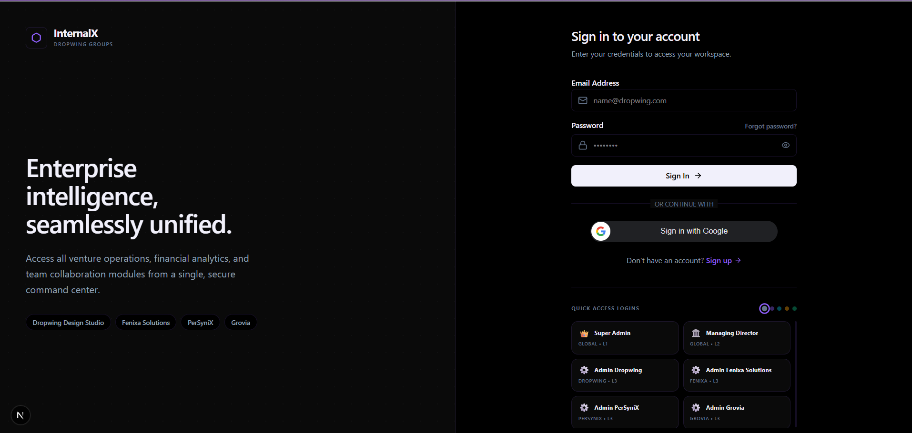
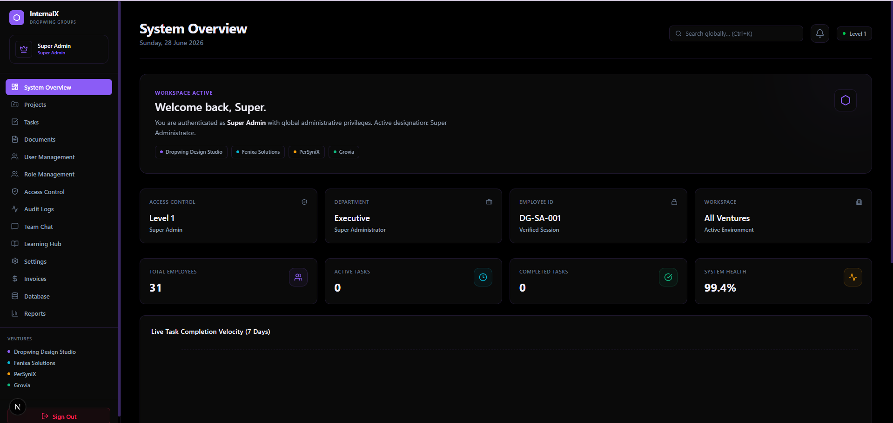
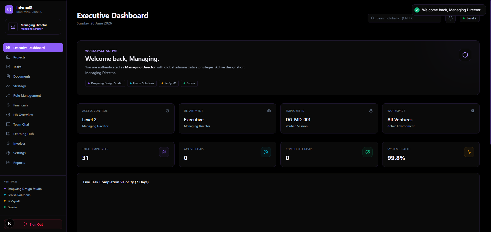
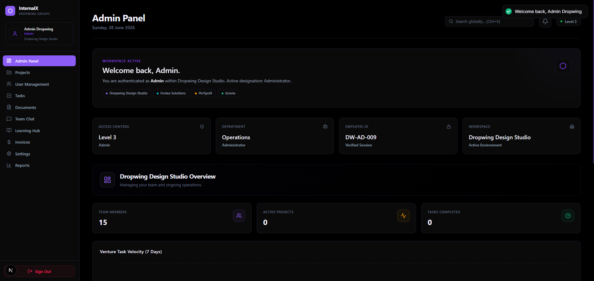
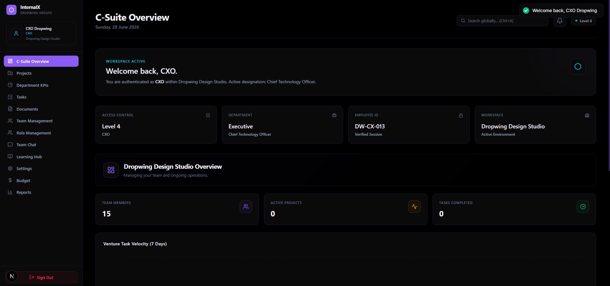
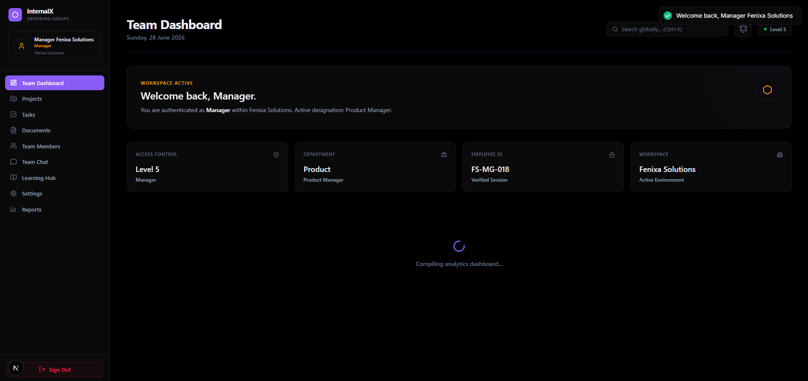
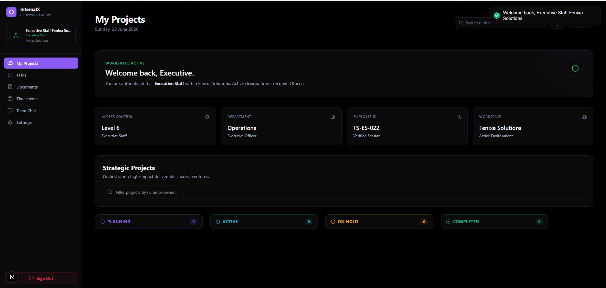
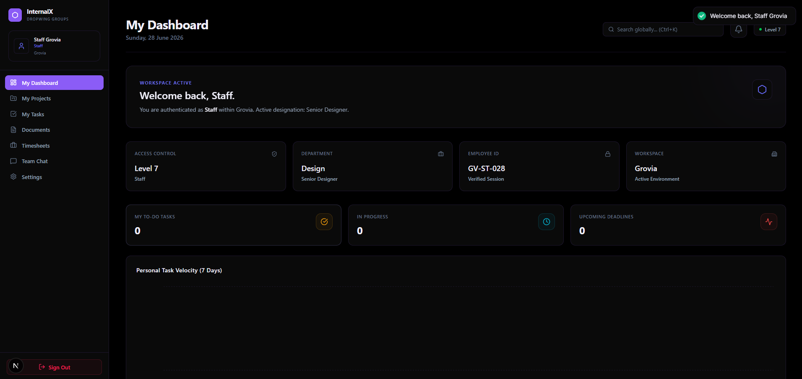
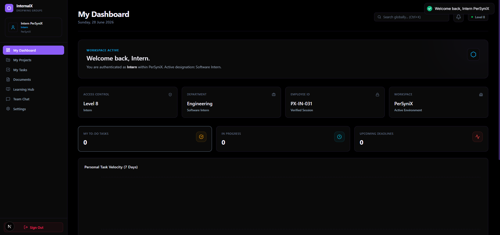
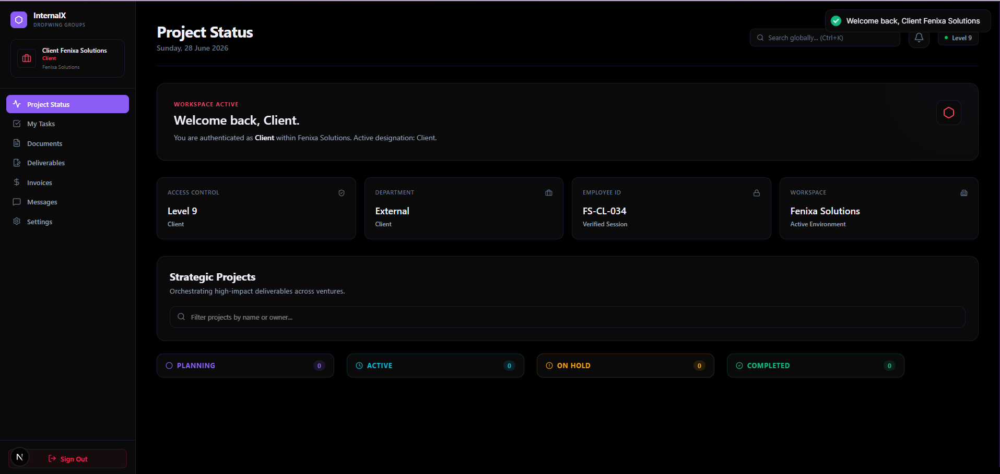

<div align="center">


# ✦ InternalX

**One internal operating system for a multi-venture company — web, mobile, and API.**

Most internal tools are *either* an ERP, *or* a CRM, *or* a project tracker, *or* a chat app.
InternalX is the single place where a holding company runs **all** of it: four separate business
ventures, nine tiers of access, and every module from OKRs to invoices to the intern onboarding
checklist — behind one login.

[Features](#-what-it-actually-does) · [Screenshots](#-screenshots) · [Architecture](#-architecture) · [Quick start](#-quick-start) · [API](#-api-reference) · [Deployment](#-deployment) · [Security](#-security)

<br/>


</div>

---

## 📖 Contents

- [Why this exists](#-why-this-exists)
- [What it actually does](#-what-it-actually-does)
- [Screenshots](#-screenshots)
- [Architecture](#-architecture)
- [Tech stack](#-tech-stack)
- [Repository layout](#-repository-layout)
- [Quick start](#-quick-start)
- [Configuration](#-configuration)
- [Access model](#-access-model)
- [API reference](#-api-reference)
- [Data model](#-data-model)
- [Mobile app](#-mobile-app)
- [Deployment](#-deployment)
- [Security](#-security)
- [Roadmap](#-roadmap)
- [License](#-license)

---

## 🌐 Why this exists

**Dropwing Groups** is not one company — it is four:

| Venture | What it does |
| :-- | :-- |
| **Dropwing Design Studio** | Brand and product design |
| **Fenixa Solutions** | Software services |
| **PerSyniX** | Technology R&D |
| **Grovia** | Growth and marketing |

Running four ventures on four sets of SaaS tools meant four billing relationships, four user
directories, and no way to answer a question like *"what did engineering across all ventures spend
last quarter, and who approved it?"* without exporting spreadsheets.

InternalX replaces that. **One database, one identity, one audit trail** — with venture-scoped data
isolation so a Fenixa manager sees Fenixa's numbers, a Managing Director sees all four, and an
external client sees only their own project.

This is the part that makes it different from a generic ERP or CRM template: the app is not built
around *records*, it is built around **who is allowed to see which venture's records**, and that rule
is enforced at the route layer, the query layer, and the UI layer.

---

## ⚡ What it actually does

InternalX is nineteen modules sharing one permission system. Grouped by what they're for:

<table>
<tr><th align="left">Domain</th><th align="left">Modules</th></tr>
<tr>
<td><strong>🏢 Operations</strong></td>
<td>

**Projects** — milestones, team assignment, per-venture boards
**Tasks** — assignment, priority, status, level-gated create/delete
**Timesheets** — logging, manager approval workflow, cost rollup
**Documents** — upload, per-venture visibility, soft delete

</td>
</tr>
<tr>
<td><strong>💰 Finance</strong></td>
<td>

**Invoices** — generation, line items, client-facing PDF export
**Budget** — expense tracking, monthly burn, per-venture summaries
**Reports** — cross-venture analytics, exportable via `jsPDF`

</td>
</tr>
<tr>
<td><strong>🧭 Strategy</strong></td>
<td>

**Strategy / OKRs** — objectives, key results, progress rollup
**Strategic risks** — register with severity and ownership
**Department KPIs** — HR and per-department metric dashboards

</td>
</tr>
<tr>
<td><strong>👥 People</strong></td>
<td>

**User management** — full CRUD, employee IDs, venture assignment
**Role management** — custom venture roles, duplication, bulk assignment
**Access control** — per-level permission matrix and 2FA config
**Learning Hub** — intern onboarding checklists, resources, feedback loop

</td>
</tr>
<tr>
<td><strong>💬 Collaboration</strong></td>
<td>

**Team Chat** — real-time, Socket.IO, venture rooms + direct messages, persisted to Postgres
**Notifications** — in-app bell, read/unread state, FCM push on mobile
**Client Portal** — a restricted L9 surface where external clients track their own work only

</td>
</tr>
<tr>
<td><strong>🔍 Governance</strong></td>
<td>

**Audit logs** — every privileged action, actor, and timestamp
**Database explorer** — read-only table browser for L1, for support without shell access

</td>
</tr>
</table>

**Also worth knowing:**

- **Real-time** — Socket.IO with JWT handshake auth; messages broadcast to venture rooms and DM rooms, then persisted.
- **Auth** — email + password (bcrypt, 12 rounds), Google OAuth, email OTP verification, and password reset over SMTP.
- **Cross-platform** — the Flutter app is not a webview. It's 28 native screens against the same REST API.
- **Design system** — "Nebula": a shared token set implemented twice, as CSS custom properties for web and as a Flutter `ThemeExtension`, so both clients stay visually identical in light and dark mode.

---

## 📸 Screenshots

> The same application, rendered for nine different access levels. Note that the sidebar,
> the metric tiles, and the venture list all change based on who signed in — that is the
> access model doing its job, not six different pages.

<div align="center">

**Sign-in**


</div>

<table>
<tr>
<td width="50%"><strong>L1 · Super Admin</strong><br/><em>All four ventures, system health, every module</em><br/></td>
<td width="50%"><strong>L2 · Managing Director</strong><br/><em>Cross-venture strategy and financial oversight</em><br/></td>
</tr>
<tr>
<td><strong>L3 · Admin</strong><br/><em>Administrative control, scoped to one venture</em><br/></td>
<td><strong>L4 · CXO</strong><br/><em>Cross-departmental visibility, no user administration</em><br/></td>
</tr>
<tr>
<td><strong>L5 · Manager</strong><br/><em>Team, approvals, and reporting</em><br/></td>
<td><strong>L6 · Executive Staff</strong><br/><em>Expanded task and document access</em><br/></td>
</tr>
<tr>
<td><strong>L7 · Staff</strong><br/><em>Day-to-day: my tasks, my timesheets, team chat</em><br/></td>
<td><strong>L8 · Intern</strong><br/><em>Learning Hub onboarding checklist front and centre</em><br/></td>
</tr>
<tr>
<td colspan="2"><strong>L9 · Client</strong> — <em>the external portal: their projects, their invoices, nothing else</em><br/></td>
</tr>
</table>

📘 A walkthrough of every screen lives in **[docs/visual-guide.md](docs/visual-guide.md)**.

---

## 🏗 Architecture

```
                    ┌──────────────────────┐     ┌──────────────────────┐
                    │   Next.js 16 (web)   │     │  Flutter 3 (mobile)  │
                    │  React 19 · TS · TW4 │     │  Riverpod · go_router│
                    │  19 dashboard views  │     │   28 native screens  │
                    └──────────┬───────────┘     └──────────┬───────────┘
                               │                            │
                        REST + WebSocket            REST + WebSocket + FCM
                               │                            │
                               └────────────┬───────────────┘
                                            │
                            ┌───────────────▼────────────────┐
                            │      Express 4 API server      │
                            │                                │
                            │  helmet · cors · rate-limit    │
                            │  ─────────────────────────     │
                            │  authenticate()  → verify JWT  │
                            │  requireLevel(n) → gate route  │
                            │  ─────────────────────────     │
                            │  19 route modules, 81 endpoints│
                            │  Socket.IO (JWT handshake)     │
                            │  audit · email · notification  │
                            └───────────────┬────────────────┘
                                            │
                            ┌───────────────▼────────────────┐
                            │      PostgreSQL 16             │
                            │   24 tables · venture-scoped   │
                            └────────────────────────────────┘
```

**Three design decisions worth calling out:**

1. **Access level is a number, and lower wins.** `requireLevel(7)` admits levels 1–7 and rejects
   8–9. One comparison replaces a permission table lookup on every request, and new roles slot in
   without touching route code.

2. **`venture_id` is the tenancy boundary.** Nearly every table carries it. A `NULL` venture means
   global scope (L1/L2 only). Queries filter on it rather than relying on the UI to hide things.

3. **The Postgres layer is a compatibility shim.** `backend/src/config/database.pg.js` wraps `pg`
   with a MySQL-shaped interface (`?` placeholders, `[rows, fields]` tuples, `NOW()` → `CURRENT_TIMESTAMP`).
   That's what let the project migrate from MySQL to PostgreSQL without rewriting 81 endpoints —
   a pragmatic trade documented honestly in [docs/postgres-validation.md](docs/postgres-validation.md).

---

## 🧰 Tech stack

| Layer | Choices |
| :-- | :-- |
| **Web** | Next.js 16 (App Router, Turbopack) · React 19 · TypeScript 5 · Tailwind CSS 4 · Framer Motion · Recharts · lucide-react · react-hot-toast · jsPDF |
| **Mobile** | Flutter 3 · Riverpod · go_router · Dio · Hive · flutter_secure_storage · Firebase Messaging |
| **API** | Node.js 18+ · Express 4 · Socket.IO 4 · JWT · bcryptjs · Multer · Nodemailer · google-auth-library |
| **Data** | PostgreSQL 16 · raw SQL (no ORM) · indexed migrations |
| **Hardening** | helmet · express-rate-limit · express-validator · cookie-parser · HTTPS redirect · CORS allowlist |
| **Ops** | Docker Compose · Cloudflare Tunnel · GitHub Actions |

**Scale:** ~14k lines TypeScript · ~26k lines Dart · ~3.9k lines backend JS · ~800 lines SQL.

---

## 📁 Repository layout

```
InternalXDropwing/
├── backend/                    Express API server
│   ├── src/
│   │   ├── config/             DB pool, Postgres compat shim, schema.sql
│   │   ├── controllers/        Business logic
│   │   ├── middleware/         authenticate() · requireLevel()
│   │   ├── routes/             19 route modules
│   │   ├── services/           email · notifications · audit
│   │   └── server.js           App bootstrap + Socket.IO
│   ├── migrations/             Incremental schema changes
│   ├── postgres_migration/     MySQL → Postgres migration reports
│   ├── seed_pg.js              Seed ventures, levels, demo users
│   └── .env.example
│
├── frontend/                   Next.js 16 web client
│   └── src/
│       ├── app/dashboard/      19 feature views + shell
│       ├── components/ui/      Nebula design system (Button, Card, Modal…)
│       ├── components/         RequireAuth · SocketProvider · GoogleAuthProvider
│       └── lib/                API client, types, constants
│
├── mobile/                     Flutter client
│   └── lib/
│       ├── core/               theme · router · api · socket · cache
│       └── features/           20 features, 28 screens (clean architecture)
│
├── deployment/
│   ├── postgres/               Production compose + init SQL + backup scripts
│   └── cloudflare/             Tunnel config + one-command deploy
│
├── docs/                       Screenshots, visual guide, deployment guides
├── scripts/                    Dev helpers and smoke tests
└── docker-compose.yml          Local PostgreSQL for development
```

---

## 🚀 Quick start

**Prerequisites:** Node.js 18+, Docker (or a local PostgreSQL 16), and Flutter 3.3+ for the mobile app.

### 1 · Database

```bash
git clone https://github.com/Santhosh-zeta/InternalXDropwing.git
cd InternalXDropwing

docker compose up -d      # PostgreSQL 16 on :5432, schema + seed applied automatically
```

Running without Docker? Create the database by hand and apply the init scripts in order:

```bash
createdb internalx
psql -d internalx -f deployment/postgres/init/01_schema.sql
psql -d internalx -f deployment/postgres/init/02_indexes.sql
psql -d internalx -f deployment/postgres/init/03_seed.sql
```

### 2 · API

```bash
cd backend
cp .env.example .env      # then edit — see Configuration below
npm install
npm run seed              # optional: demo ventures, levels and users
npm run dev               # → http://localhost:5000
```

Verify it's up:

```bash
curl http://localhost:5000/api/health
# {"status":"ok","message":"InternalX API is running", ...}
```

### 3 · Web

```bash
cd frontend
cp .env.example .env.local
npm install
npm run dev               # → http://localhost:3000
```

In development the login page shows **Quick Access Logins** — one-click buttons for each seeded
access level, so you can see all nine dashboards without creating accounts. These are compiled out
of production builds (`NODE_ENV === 'production'` returns an empty list), so the demo passwords
cannot reach a production bundle.

### 4 · Mobile *(optional)*

```bash
cd mobile
flutter pub get
flutter run --dart-define=API_URL=http://10.0.2.2:5000/api   # 10.0.2.2 = host from Android emulator
```

---

## ⚙️ Configuration

Every service reads configuration from environment variables. **Nothing secret is committed** —
copy the `.env.example` templates and fill them in locally.

### `backend/.env`

| Variable | Required | Notes |
| :-- | :-: | :-- |
| `NODE_ENV` | ✓ | `development` \| `production` |
| `PORT` | ✓ | Default `5000` |
| `FRONTEND_URL` | ✓ | CORS origin **and** the base for links in outgoing email |
| `DB_HOST` `DB_PORT` `DB_NAME` `DB_USER` `DB_PASSWORD` | ✓ | PostgreSQL connection |
| `JWT_SECRET` | ✓ | Long random string — see below |
| `JWT_EXPIRES_IN` | | Default `8h` |
| `GOOGLE_CLIENT_ID` / `GOOGLE_CLIENT_SECRET` | | Omit to disable Google sign-in |
| `SMTP_HOST` `SMTP_PORT` `SMTP_SECURE` `SMTP_USER` `SMTP_PASS` | | Omit to disable OTP and password reset email |

Generate a JWT secret:

```bash
node -e "console.log(require('crypto').randomBytes(48).toString('base64url'))"
```

### `frontend/.env.local`

| Variable | Notes |
| :-- | :-- |
| `NEXT_PUBLIC_API_URL` | Backend base URL, no trailing slash — e.g. `http://localhost:5000/api` |
| `NEXT_PUBLIC_GOOGLE_CLIENT_ID` | Must match the backend's `GOOGLE_CLIENT_ID`; blank hides the Google button |

> `NEXT_PUBLIC_*` variables are inlined into the browser bundle. Never put a secret behind that prefix.

### Mobile

Passed at build time, not through a file:

```bash
flutter run --dart-define=API_URL=https://your-api-host/api
```

---

## 🔐 Access model

Nine levels. **Lower number = more access.** `requireLevel(n)` admits every level from `1` to `n`.

| L | Role | Scope |
| :-: | :-- | :-- |
| **1** | Super Admin | Everything, all ventures, including the database explorer |
| **2** | Managing Director | Strategic + financial oversight across all ventures |
| **3** | Admin | Full administration of **one** assigned venture |
| **4** | CXO | Cross-departmental visibility; no user administration |
| **5** | Manager | Team management, timesheet approval, reporting |
| **6** | Executive Staff | Senior staff — expanded task and document access |
| **7** | Staff | Standard employee: own tasks, timesheets, chat, documents |
| **8** | Intern | Limited, Learning-Hub-centric |
| **9** | Client | External portal — their own projects and invoices only |

Enforcement happens in three places, and all three have to agree:

```js
// 1. Route layer — backend/src/routes/task.routes.js
router.post('/',       authenticate, requireLevel(7), createTask);   // L1–L7 may create
router.delete('/:id',  authenticate, requireLevel(5), deleteTask);   // only L1–L5 may delete

// 2. Query layer — venture scope is applied in SQL, not in the UI
//    WHERE venture_id = $1 OR $2 <= 2      ← L1/L2 bypass venture scoping

// 3. UI layer — <RequireAuth> gates routes, and the sidebar renders per level
```

Sessions are JWTs, stored in an `internalx_token` cookie and also accepted as
`Authorization: Bearer`. The Socket.IO handshake verifies the same token before joining any room,
so a chat connection cannot outlive or outrank the HTTP session.

---

## 🔌 API reference

Base URL `/api`. All routes except `/api/health` and `/api/auth/*` require a valid token.

<details>
<summary><strong>Authentication</strong> — <code>/api/auth</code></summary>

| Method | Path | Purpose |
| :-- | :-- | :-- |
| `POST` | `/register` | Create account, send OTP |
| `POST` | `/login` | Email + password → JWT |
| `POST` | `/google-login` | Google ID token → JWT (auto-verified) |
| `POST` | `/verify-otp` | Confirm email address |
| `POST` | `/forgot-password` | Email a reset link |
| `POST` | `/reset-password` | Consume reset token |
| `POST` | `/logout` | Clear session cookie |
| `GET` | `/me` | Current user + venture + level |

</details>

<details>
<summary><strong>People & access</strong> — <code>/api/team-members</code>, <code>/api/role-management</code>, <code>/api/access-control</code></summary>

| Method | Path | Purpose |
| :-- | :-- | :-- |
| `GET` | `/team-members` | List users (venture-scoped) |
| `POST` `PUT` `DELETE` | `/team-members/:id` | User CRUD |
| `GET` `PUT` | `/team-members/me/profile` | Own profile |
| `PUT` | `/team-members/me/password` | Change own password |
| `POST` | `/team-members/me/avatar` | Avatar upload (Multer) |
| `GET` | `/team-members/ventures` · `/access-levels` | Reference data |
| `GET` `POST` `PUT` `DELETE` | `/role-management` | Custom venture roles |
| `POST` | `/role-management/:id/duplicate` | Clone a role |
| `POST` `DELETE` | `/role-management/assign` | Bulk assign / unassign |
| `GET` `PUT` | `/access-control/:level` | Per-level permission matrix |
| `GET` `PUT` | `/access-control/2fa-config` | Two-factor policy |

</details>

<details>
<summary><strong>Work</strong> — <code>/api/projects</code>, <code>/api/tasks</code>, <code>/api/timesheets</code>, <code>/api/documents</code></summary>

| Method | Path | Gate |
| :-- | :-- | :-- |
| `GET` `POST` `PUT` `DELETE` | `/projects`, `/projects/:id` | Level-gated |
| `GET` | `/tasks`, `/tasks/:id` | Any authenticated user |
| `POST` `PUT` | `/tasks` | `requireLevel(7)` |
| `DELETE` | `/tasks/:id` | `requireLevel(5)` |
| `POST` `GET` | `/timesheets` | Log and list entries |
| `PATCH` | `/timesheets/:id/approve` | Manager approval |
| `GET` | `/timesheets/financials` | Cost rollup |
| `POST` | `/documents/upload` | Multer upload |
| `GET` `DELETE` | `/documents`, `/documents/:id` | Venture-scoped |

</details>

<details>
<summary><strong>Money & insight</strong> — <code>/api/invoices</code>, <code>/api/budget</code>, <code>/api/kpis</code>, <code>/api/strategy</code>, <code>/api/platform-metrics</code></summary>

| Method | Path | Purpose |
| :-- | :-- | :-- |
| `GET` | `/invoices`, `/invoices/:id` | Invoice list and detail |
| `GET` | `/budget/summary` · `/expenses` · `/monthly` | Budget analytics |
| `GET` | `/kpis/hr` · `/kpis/department` | KPI dashboards |
| `GET` | `/strategy` | OKRs, key results, strategic risks |
| `GET` | `/platform-metrics` | Cross-venture platform analytics |
| `GET` | `/client-portal/overview` | L9 client-scoped summary |

</details>

<details>
<summary><strong>Collaboration & governance</strong> — <code>/api/chat</code>, <code>/api/notifications</code>, <code>/api/learning</code>, <code>/api/action-logs</code>, <code>/api/database</code></summary>

| Method | Path | Purpose |
| :-- | :-- | :-- |
| `GET` `POST` | `/chat/messages` | Message history and send |
| `GET` | `/notifications` | Inbox |
| `PATCH` | `/notifications/:id/read` · `/read-all` | Mark read |
| `DELETE` | `/notifications/clear` | Clear all |
| `GET` `POST` `DELETE` | `/learning/checklist` · `/resources` · `/feedback` | Learning Hub |
| `GET` `PATCH` | `/learning/progress` | Intern progress tracking |
| `GET` | `/action-logs` | Audit trail |
| `GET` `POST` | `/database/tables` · `/table/:name` · `/query` | **L1 only** — read-only explorer |

</details>

### WebSocket events

| Direction | Event | Payload |
| :-- | :-- | :-- |
| → server | `join_channel` | `channelId` (`global`, `venture_<id>`, or `dm_<userId>`) |
| → server | `send_message` | `{ content, ventureId? , receiverId? }` |
| ← client | `receive_message` | `{ content, sender_id, ventureId?, receiverId? }` |

The handshake requires `auth.token` (or an `Authorization` header). `sender_id` is taken from the
verified token, never from the client payload — a client cannot spoof who a message came from.

---

## 🗄 Data model

24 tables. The ones that carry the design:

| Table | Role |
| :-- | :-- |
| `ventures` | The four businesses — the tenancy root |
| `access_levels` | L1–L9 definitions |
| `users` | Employee ID, bcrypt hash, `access_level`, `venture_id` |
| `sessions` | Backs real server-side token revocation — checked on every authenticated request and the Socket.IO handshake |
| `venture_roles` · `venture_role_assignments` | Custom roles layered on top of levels |
| `projects` · `project_members` · `project_milestones` | Delivery |
| `tasks` · `task_assignees` · `timesheets` | Execution, shared ownership, and time capture |
| `okrs` · `key_results` · `strategic_risks` | Strategy |
| `documents` · `announcements` | Content |
| `messages` · `notifications` | Communication |
| `learning_checklist_items` · `learning_intern_progress` · `learning_resources` · `learning_feedback` | Onboarding |
| `audit_logs` | Every privileged mutation |

Schema: [`deployment/postgres/init/01_schema.sql`](deployment/postgres/init/01_schema.sql) ·
Indexes: [`02_indexes.sql`](deployment/postgres/init/02_indexes.sql) ·
Seed: [`03_seed.sql`](deployment/postgres/init/03_seed.sql)

---

## 📱 Mobile app

A native Flutter client — not a wrapper — covering 20 features across 28 screens: workspace, tasks,
projects, timesheets, approvals, chat, documents, budget, KPIs, strategy, analytics, audit,
calendar, team, learning hub, notifications, client portal, and profile.

- **State** — Riverpod providers, feature-scoped
- **Routing** — `go_router` with auth guards mirroring the web's `<RequireAuth>`
- **Network** — Dio with a JWT interceptor; tokens in `flutter_secure_storage`, never `SharedPreferences`
- **Offline** — Hive caches for read-heavy screens
- **Real-time** — the same Socket.IO contract as web
- **Push** — Firebase Cloud Messaging
- **Theme** — the Nebula tokens again, as a Flutter `ThemeExtension`, with a live light/dark switch

```bash
cd mobile
flutter pub get
flutter run --dart-define=API_URL=http://10.0.2.2:5000/api
flutter build apk --release --dart-define=API_URL=https://your-api-host/api
```

---

## 🚢 Deployment

**Cloudflare Tunnel** — no open inbound ports, TLS terminated at the edge:

```bash
./deployment/cloudflare/deploy-with-tunnel.sh
```

Full guides: [quick start](docs/deployment/quick-start.md) ·
[tunnel setup](docs/deployment/cloudflare-tunnel.md) ·
[summary](docs/deployment/summary.md)

**Single-server bundle** — `node build_package.js` builds the frontend, copies the backend, and
emits a deployable `DGOS-PRODUCTION/` directory plus a zip. The Express server serves the static
Next.js export from `public/frontend-build/` with an SPA fallback, so one Node process serves both
API and UI.

**Production database** — [`deployment/postgres/`](deployment/postgres/) carries a hardened compose
file, init SQL, and `backup.sh` / `restore.sh`.

### Pre-flight checklist

- [ ] `NODE_ENV=production` on the API
- [ ] `JWT_SECRET` is a fresh 48-byte random value, not the development one
- [ ] `FRONTEND_URL` is the real origin — it drives CORS *and* email links
- [ ] Database user is **not** a superuser and has no `CREATEDB`
- [ ] `backend/uploads/` is writable, backed up, and not served with execute permissions
- [ ] TLS terminated in front of the app (the server force-redirects HTTP in production)
- [ ] `deployment/postgres/backup/backup.sh` scheduled

---

## 🛡 Security

Implemented:

| Control | Where |
| :-- | :-- |
| Password hashing — bcrypt, 12 rounds | `auth.controller.js` |
| JWT sessions, 8 h expiry, httpOnly cookie — and a real server-side revocation check, so logout actually ends the session instead of waiting out the 8 hours | `auth.middleware.js`, `session.service.js` |
| The session token never touches client-side JavaScript — no `localStorage`, no JS-writable cookie. The web app trusts only the server-verified `/api/auth/me` response for who's signed in, not a client-editable cache | `frontend/src/lib/api.ts`, `frontend/src/components/RequireAuth.tsx` |
| OTPs hashed (HMAC-SHA256) and compared in constant time | `otp.js` |
| Level-based route authorisation | `requireLevel()` |
| Venture scoping enforced in SQL | every controller |
| Socket.IO handshake authentication — token, header, or the same httpOnly cookie, revocation-checked | `server.js` |
| Upload MIME/extension allowlist; authenticated, venture-scoped document downloads | `upload.middleware.js`, `uploads.routes.js` |
| Read-only-enforced SQL console for L1 — single `SELECT`, no chaining, row cap, statement timeout, every attempt audit-logged | `sqlGuard.js`, `database.routes.js` |
| Parameterised queries throughout (no ORM, no string-built SQL) | `database.pg.js` |
| A real Content-Security-Policy — see [SECURITY.md](SECURITY.md) for the specific, documented exceptions it needs | `server.js` |
| Rate limiting across the whole API, tighter on uploads/the SQL console/reports, keyed on the verified user id | `rateLimit.middleware.js` |
| Request validation on every mutating endpoint | `validate.middleware.js` |
| CORS allowlist (single origin, credentials on) | `server.js` |
| Forced HTTPS in production | `server.js` |
| Audit logging of privileged actions | `audit.service.js` |
| Demo credentials stripped from production builds | `lib/constants.ts` |

Reporting a vulnerability: **[SECURITY.md](SECURITY.md)**.

> **Note for anyone cloning this repo:** every credential is supplied through environment
> variables and no `.env` file is tracked. If you fork it, generate your own `JWT_SECRET` and
> database password before exposing anything to a network.

---

## 🗺 Roadmap

- [ ] Automated test suite (Jest + Supertest for the API, Playwright for the web)
- [ ] OpenAPI 3 specification generated from the route modules
- [ ] A nonce-based CSP — needs the frontend build to move off a static export so a nonce can be
      stamped in per request; see [SECURITY.md](SECURITY.md) for what today's policy has to allow
      without one
- [ ] Redis adapter for Socket.IO, to scale past one API process
- [ ] Per-venture theming in the client portal
- [ ] Structured logging (pino) with request IDs end to end

---

## 📄 License

Released under the **MIT License** — see [LICENSE](LICENSE).

Copyright © 2026 Dropwing Groups. You're free to use, modify and distribute this, including
commercially, as long as the copyright notice travels with it.

---

<div align="center">

**Built by [Santhosh V](https://github.com/Santhosh-zeta) for Dropwing Groups.**

<sub>Four ventures. One login. One audit trail.</sub>

</div>
