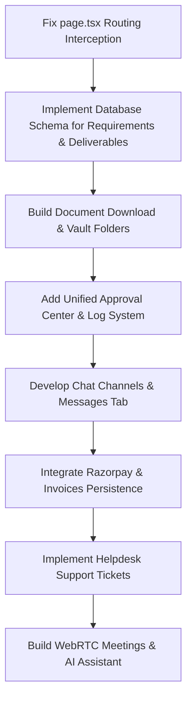

# InternalX — Client Portal (L9) Product Specification & Gap Analysis

> **Status note.** This is a product-vision gap analysis. The "current implementation" column is a historical snapshot and partly outdated: the access rules that are enforced today (client scope, client-visible documents, no internal chat for clients) are described in [data-isolation.md](data-isolation.md).

This document provides a comprehensive technical audit and functional comparison between the **InternalX Client Portal (Level 9 Access) Product Vision** and the **Current Codebase Implementation**. It highlights critical bugs, missing UI/backend features, security boundaries, and architectural implementation guidelines.

---

## 1. Technical & Architectural Comparison

The following table summarizes the gap between the Product Vision and what is currently implemented in the frontend (`ClientPortalView.tsx`, `page.tsx`) and the backend (`client_portal.routes.js`, Database Schema).

| Product Vision Section | Current Implementation Status | Missing Frontend (UI) Features | Missing Backend (API & DB) Features |
| :--- | :--- | :--- | :--- |
| **Access Control & Routing** | ⚠️ Intercepted by Employee Views | Reordering in routing conditions so that Client (L9) menu options load `ClientPortalView` instead of employee `ProjectsView`. | None (Basic L9 checks exist, but require rigorous route validation). |
| **Home Dashboard** | ⚠️ Minimal Count Metrics | Account Manager card, Upcoming Meetings list, Pending Approvals card, Recent Updates feed, Open Support Tickets widget, Recent Deliverables carousel, and all "Quick Action" buttons. | Endpoints/DB joins to fetch Account Manager info, meeting schedules, active support tickets, and recent activity logs. |
| **Project Center** | ⚠️ Read-only Grid List (No Details) | Detailed sub-tabs (Overview, Milestones, Deliverables, Requirements, Timeline, Documents, Approvals) upon selecting a project. | Database tables and associations linking projects to milestones, change requests, and client-visible timelines. |
| **Live Project Timeline** | ❌ Completely Missing | Chronological activity feed with event-type filters (Today, This Week, This Month, Project, Event Type). | Log triggers and a `project_activities` schema to record events (e.g., build released, payment received). |
| **Requirement Center** | ❌ Completely Missing | Forms to submit new requirements, upload mockups, set priority, track status flows, and write comment threads. | `requirements` table in SQL, status workflow state machine, file upload endpoints. |
| **Change Request Center** | ❌ Completely Missing | Change request submission form (scope description, cost impact, timeline impact) and manager feedback pane. | `change_requests` table, cost and timeline adjustment APIs, approval workflow states. |
| **Communication Hub** | ❌ Missing on Client Side | Real-time chat client interface, threaded chats, voice note player, announcements panel, pinned messages list. | Client-safe WebSocket namespaces, client-venture chat channel routing, message persistence tables. |
| **InternalX Meetings** | ❌ Completely Missing | In-portal video/audio interface, screen sharing button, chat sidebar, transcription summary panel. | WebRTC signaling server, meeting scheduling DB schema, automatic meeting summary/action item AI pipeline. |
| **Deliverables Center** | ⚠️ Read-only Task List mapping | Filterable grids for UI designs, code packages, APK files, build links. Actions to approve/reject/request revisions. | `deliverables` table, asset storage links, approval state machines (Draft -> Submitted -> Approved/Rejected). |
| **Documents Vault** | ⚠️ Non-functional List | Folders (Contracts, NDAs, Proposals), version history preview modal, search bar, download handler hook. | File versioning schema, file download stream APIs (`/api/documents/download/:id`). |
| **Approval Center** | ❌ Completely Missing | Unified approval inbox showing pending items (UI designs, change requests, deliverables) with Approve/Reject actions. | `approvals_audit_log` table storing `user_id`, `timestamp`, `comments`, and status hashes. |
| **Financial Center** | ⚠️ Simulated Timesheet-based Grid | Payment checkout portal, receipts download list, payment history ledger, payment status tracking. | Razorpay checkout webhooks, actual `invoices` and `payments` tables (replacing timesheet-derived calculations). |
| **Support Center** | ❌ Completely Missing | Ticket creation forms, file attachment zone, interactive priority flags (Critical, High, Medium, Low). | `support_tickets` table, assignee assignment logic, support conversation databases. |
| **Notifications Center** | ⚠️ Non-functional bell | Real-time push messages for ticket updates, invoice generations, and announcement notices. | Event-driven WebSocket dispatchers triggering alerts upon document uploads, payment receipts, etc. |
| **Activity History** | ❌ Completely Missing | Structured audit log page showing historical timeline of client-related transactions and changes. | `client_activity_logs` audit trail system. |
| **AI Client Assistant** | ❌ Completely Missing | Embedded chat drawer prompting assistant with context. | Scoped retrieval-augmented generation (RAG) backend connected to client-only documents, invoices, and timeline logs. |
| **Client Profile** | ❌ Completely Missing | Roster showing company information, timezone selection, timezone offset, primary contact, email settings. | `/api/client/profile` CRUD endpoints, company settings schema. |
| **Announcements** | ❌ Completely Missing | Renders global release notes, holiday announcements, and server maintenance warning banners. | `announcements` database table with target-audience filtering. |

---

## 2. In-Depth Feature Architecture & Gaps

### 1. Home Dashboard
* **Current State:** A simple banner greeting the user alongside static summary cards displaying count statistics for Projects, Deliverables, Invoices, and Documents.
* **Product Vision Requirements:**
  - **Account Manager:** A card displaying contact information (Name, Avatar, Email, Phone) of the assigned Dropwing account manager.
  - **Widgets:** Dynamic widgets for "Upcoming Meetings", "Pending Invoices", and "Open Support Tickets".
  - **Quick Actions:** Single-click buttons to "Raise Requirement", "Start Conversation", "Join Meeting", and "Raise Support Ticket".
* **Backend Requirements:** Endpoints must map the logged-in client's `venture_id` to their designated account manager (from a user mapping table), active support tickets, and scheduling ledgers.

### 2. Project Center & Project View
* **Current State:** Standard grid display mapping titles, progress percentages, and status values directly.
* **Product Vision Requirements:**
  - Clicking a project card must open a detailed **Project View** rather than doing nothing.
  - Project Detail pages must contain tabbed navigation: **Overview, Milestones, Deliverables, Requirements, Timeline, Documents, Approvals**.
* **Backend Requirements:** Association queries to fetch milestones (`project_milestones`), linked deliverables (`tasks`), and requirements (`requirements`) specifically mapped to a single `project_id`.

### 3. Live Project Timeline
* **Current State:** Non-existent.
* **Product Vision Requirements:**
  - A vertical chronological feed tracking key events: *Project Created, Design Submitted, Requirement Approved, Milestone Completed, Meeting Scheduled, Build Released, Invoice Generated, Payment Received*.
  - Search and filter tools supporting time frames (Today, This Week, This Month) and event categories.
* **Backend Requirements:** An event-listener architecture that inserts logs into a `project_activities` table whenever an internal staff member marks a milestone complete, uploads a design, or generates an invoice.

### 4. Requirement Center
* **Current State:** Non-existent.
* **Product Vision Requirements:**
  - Standard interface for raising/tracking software features or design directives.
  - Form support for uploading attachments, defining priority, and commenting.
  - State workflow tracking: `Draft` ➔ `Submitted` ➔ `Under Review` ➔ `Approved` ➔ `In Progress` ➔ `Testing` ➔ `Completed` ➔ `Delivered`.
* **Backend Requirements:**
  - Schema: `requirements` (id, project_id, title, description, priority, status, created_by, created_at).
  - Comment threads table (`requirement_comments`) and attachment links table.

### 5. Change Request Center
* **Current State:** Non-existent.
* **Product Vision Requirements:**
  - Interface for managing out-of-scope adjustments. Contains description input, business rationale, cost impact indicator, and schedule impact logs.
  - State workflow tracking: `Submitted` ➔ `Review` ➔ `Quotation` ➔ `Approval` ➔ `Implementation` ➔ `Completed`.
* **Backend Requirements:** `change_requests` schema linked to project budgets. Approval triggers must increment project budgets and adjust timeline parameters on approval.

### 6. Communication Hub (Client Messages)
* **Current State:** The backend has `/api/chat` routes and WebSocket support, but the frontend client views have no messaging tabs.
* **Product Vision Requirements:**
  - Real-time client-venture chat window.
  - Support for threaded chats, emoji reactions, voice note recorders, read receipts, and message pinning.
  - Dedicated channels: `General`, `Requirements`, `Design Review`, `Billing`, `Support`, `Announcements`.
* **Backend Requirements:** Socket.io namespaces or rooms segmented strictly by client-venture identifier, ensuring client isolation.

### 7. InternalX Meetings
* **Current State:** Non-existent.
* **Product Vision Requirements:**
  - Embeddable audio/video meeting player utilizing WebRTC.
  - Meeting scheduler showing timezone adjustments.
  - Meeting artifacts: Automatic recording link, transcript log, summaries, and action items.
* **Backend Requirements:** WebRTC signaling coordinator (e.g. via Socket.io or a dedicated server). AI integration (e.g., Google Gemini API) to summarize meetings and output transcript arrays.

### 8. Deliverables Center
* **Current State:** Mapped directly to internal developer tasks from the database, meaning clients see task boards instead of final client-ready artifacts.
* **Product Vision Requirements:**
  - Displays actual completed items: UI/UX Designs (Figma embeds), Source Code Packages, APK builds, and live deployment URLs.
  - Approval state tracking: `Draft` ➔ `Submitted` ➔ `Approved` ➔ `Rejected` ➔ `Revision Requested` ➔ `Completed`.
* **Backend Requirements:** A `deliverables` table separate from the employee `tasks` table, allowing developers to upload client-facing files with draft/release states.

### 9. Documents Vault
* **Current State:** Flat read-only list with no file download endpoints hooked up to the card triggers.
* **Product Vision Requirements:**
  - Folder hierarchy organizing documents by types: *Contracts, NDAs, Proposals, Quotations, Invoices, Reports, Deliverables, Manuals*.
  - Version history tracking, file search, and inline file previewers.
* **Backend Requirements:** File directory mappings, storage bucket management, version metadata schemas, and secure file streaming handlers.

### 10. Approval Center
* **Current State:** Non-existent.
* **Product Vision Requirements:**
  - Centralized portal compiling all open approval requests (UI designs, cost estimates, milestone sign-offs).
  - Actions: **Approve, Reject, Request Changes** with input comments.
* **Backend Requirements:** `approvals` table capturing state hashes, timestamp markers, and audit user information.

### 11. Financial Center
* **Current State:** Dynamic invoices generated on-the-fly by querying timesheets and multiplying hours worked by $50. No actual invoice payment processing exists.
* **Product Vision Requirements:**
  - Detailed list of actual invoices, receipts, upcoming payment dates, and payment logs.
  - Razorpay credit card checkout interface.
* **Backend Requirements:** Payment ledger schemas, Razorpay payment processing integrations, and transition handlers updating status on successful webhook receipts.

### 12. Support Center
* **Current State:** Non-existent.
* **Product Vision Requirements:**
  - Client support ticketing console.
  - Ticket states: `Open` ➔ `Assigned` ➔ `In Progress` ➔ `Waiting for Client` ➔ `Resolved` ➔ `Closed`.
  - Priority toggles: `Low`, `Medium`, `High`, `Critical`.
* **Backend Requirements:** `support_tickets` and `ticket_messages` schemas with automated notification routing to helpdesk agents.

### 13. AI Client Assistant
* **Current State:** Non-existent.
* **Product Vision Requirements:**
  - Embedded AI assistant scoped exclusively to the client's venture data.
  - Responds to progress queries, finds files/invoices, and summarizes meeting logs.
* **Backend Requirements:** A vector database or scoped database retrieval pipeline feeding local client context to an LLM (e.g., Gemini API) with strict prompt constraints prohibiting access to other tenants' information.

---

## 3. Strict Security & Tenant Isolation Rules

To protect corporate integrity, the client portal must enforce strict security boundaries. The following information must **NEVER** escape backend APIs or be exposed on the frontend:

1. **Internal Operations:** Employee performance metrics, internal resource allocation, internal task backlogs, and developer task comments.
2. **Financial Data:** Corporate profit margins, employee pay rates, overhead budgets, and internal profitability analyses.
3. **Internal Communications:** Management notes, team chats (outside client channels), risk matrices, and internal strategy docs.
4. **Multi-Tenant Isolation:** Under no circumstances should a client be able to query or receive data regarding another client or venture. Every backend SQL query MUST include `WHERE venture_id = ?` verified against the authenticated user session's `venture_id`.

---

## 4. Implementation Priority & Roadmap

### Phase 1: Security & Core Fixes (Immediate)
* Reorder conditional routing checks in `frontend/src/app/dashboard/page.tsx` so clients resolve to `ClientPortalView` instead of employee screens.
* Implement the folder system and connect download endpoints for the **Documents Vault**.
* Add tenant-isolation automated tests in the backend router.

### Phase 2: Collaboration & Feedback (Short-Term)
* Create the database tables for `requirements`, `deliverables`, and `approvals`.
* Implement the **Approval Center** frontend UI and state update APIs.
* Integrate the real-time chat window and channels in a new **Messages** tab.

### Phase 3: Operations & Payments (Medium-Term)
* Build the **Support Center** ticketing workflow.
* Create concrete `invoices` and `payments` tables, replacing dynamic timesheet calculations, and integrate Razorpay webhooks.
* Implement the **Meetings** module with calendar synchronizations.

### Phase 4: Intelligence & WebRTC (Long-Term)
* Integrate WebRTC peer-to-peer signalling for live video/audio meetings.
* Implement the **AI Client Assistant** utilizing context-scoped RAG pipelines.
